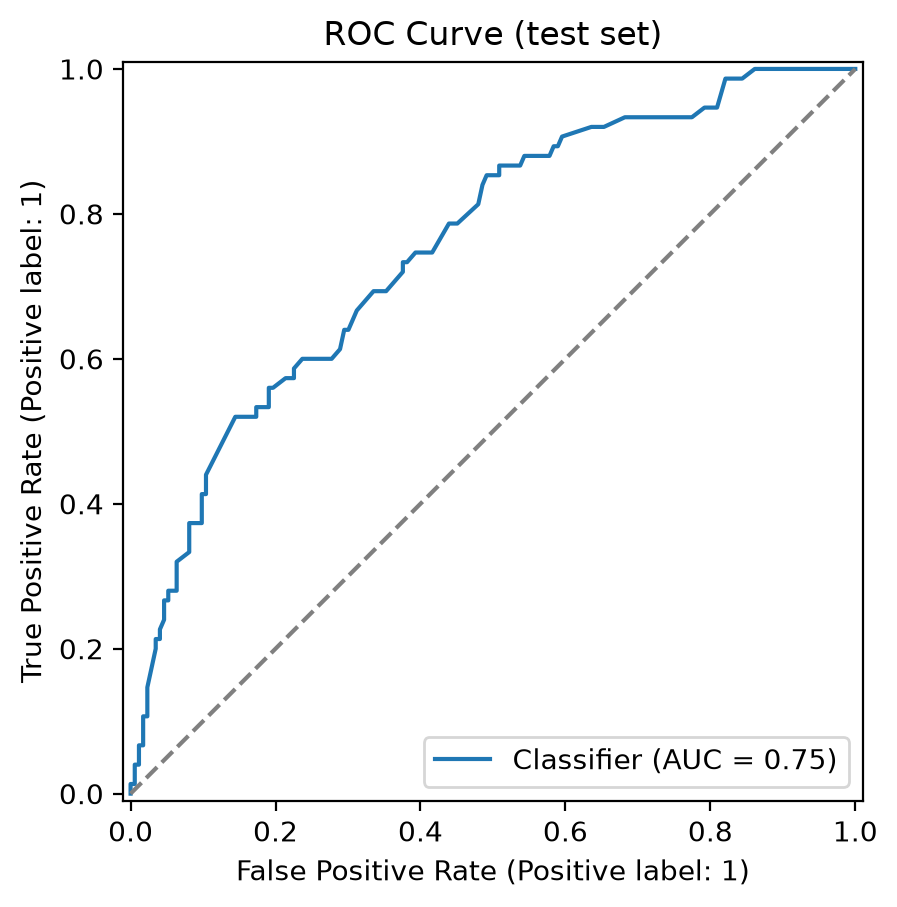
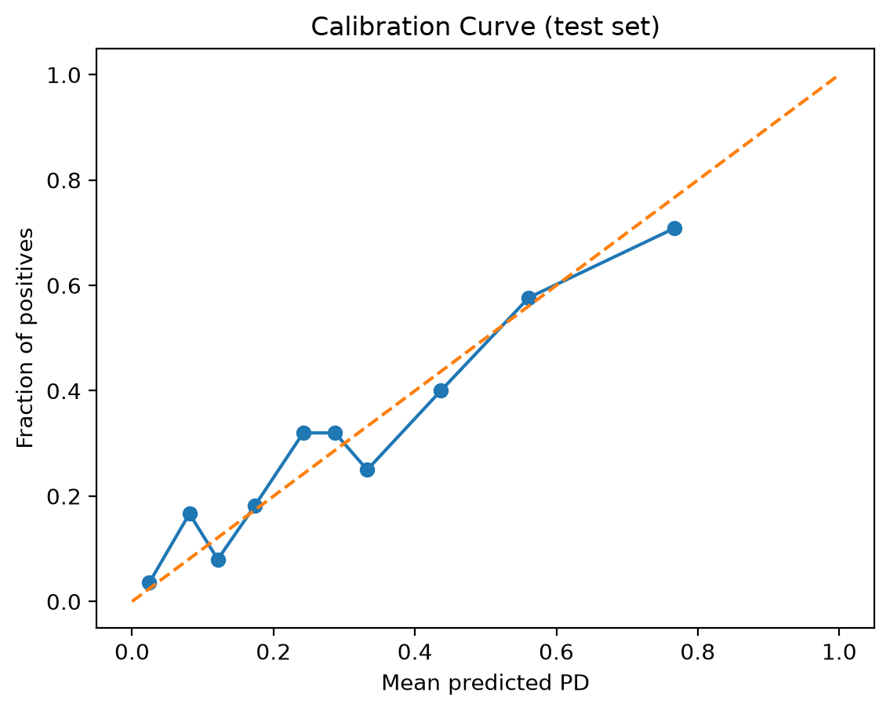

# Credit Risk PD Model (Python)

A probability-of-default (PD) model for consumer loans, built as a calibrated
logistic regression pipeline. It scores new applications into risk grades and
runs a simple stress test, evaluated with AUC, KS and Brier score.

## Results

Held-out test set: 248 loans (25%, stratified); 742 loans used for training.

| Metric | Value | Meaning |
|---|---|---|
| AUC | **0.755** | How well the model ranks defaulters above non-defaulters (0.5 = random) |
| KS | **0.387** | Largest gap between the score distributions of defaulters and non-defaulters |
| Brier score | **0.176** | Mean squared error of the predicted probabilities (lower is better; always predicting 30% scores 0.21) |

| ROC curve | Calibration curve |
|---|---|
|  |  |

**Stress test** (liquidity shock: every positive current-account balance drops
one band):

| | Base | Stressed |
|---|---|---|
| Mean PD | 30.0% | 34.5% (+449 bp) |
| Share of loans in grade E | 16.3% | 17.8% |

## Data

[South German Credit](https://archive.ics.uci.edu/dataset/522/south+german+credit)
(UCI Machine Learning Repository, 2019, [doi:10.24432/C5X89F](https://doi.org/10.24432/C5X89F)),
licensed [CC BY 4.0](https://creativecommons.org/licenses/by/4.0/). It holds 1,000
loans from a German bank, 30% of which defaulted, with 20 attributes:
- current-account and savings balances
- loan duration, amount and purpose
- credit history, employment, housing and age

This is the corrected version of the widely used Statlog German Credit data,
whose coding information contained errors (Grömping, 2019).
`src/prepare_data.py` downloads it and converts the coded values to readable
labels. It holds 10 loans back, without their outcome, as "new applications"
to demonstrate scoring.

## Method

1. **Pre-processing:** median imputation and scaling for numeric features;
   one-hot encoding for categorical ones.
2. **Model:** logistic regression with balanced class weights. The
   regularisation strength `C` is chosen by 5-fold cross-validated grid search
   on AUC.
3. **Calibration:** isotonic calibration (5-fold), so the outputs can be read
   as probabilities, not just scores. The calibration curve shows how close
   they are.
4. **Risk grades:** PDs are mapped to grades A–E, with bands set in
   `src/config.yaml`.
5. **Protected characteristics excluded:** `personal_status_sex` and
   `foreign_worker` are dropped before training, so the model cannot use sex,
   marital status or nationality.

The model's largest coefficients are in `reports/logreg_top_coeffs.csv`. The
strongest risk drivers are the current-account balance, the loan purpose, the
credit history and savings.

### Choosing the stress scenario

A stress test only makes sense if it moves inputs in a direction the data
links to higher risk. Current-account balance does: the default rate rises
from 12% to 22% to 40% as the balance falls. The instalment rate does not. In
this data, borrowers whose instalments take over 35% of their income default
*less* often (25%) than those under 20% (34%). Stressing it would have
*lowered* the predicted risk, so it is left out.

## Run it

```bash
pip install -r requirements.txt
python src/prepare_data.py   # download the data into data/raw/
python src/train.py          # train, evaluate, save the model and reports/metrics.json
python src/plots.py          # ROC and calibration plots
python src/predict.py        # score data/raw/new_applications.csv
python src/stress.py         # stress test report
```

## Project structure

```
src/
  config.yaml       paths, model settings, risk-grade bands
  prepare_data.py   download and label the dataset
  train.py          pipeline, grid search, calibration, evaluation
  plots.py          ROC and calibration curves
  predict.py        score new applications into PD + risk grade
  stress.py         liquidity-shock stress test
  utils.py          shared helpers (config, data loading, KS, grading)
data/raw/           loans.csv, new_applications.csv
reports/            metrics, plots, coefficients, scored applications, stress report
```

## Limitations

- **Unrealistic default rate:** the dataset deliberately over-samples defaults
  (30%, much higher than a real loan book). The PDs are therefore relative to
  this sample, not real-world default rates.
- **Small and old:** 1,000 loans from 1970s Germany, in Deutsche Mark, so it
  shows the method rather than giving a model fit for current lending.
- **Single split:** results come from one 75/25 split. With 248 test loans,
  expect a few points of variation in AUC between splits.

## Licence

Code: MIT. Data: CC BY 4.0, from the UCI Machine Learning Repository (see above).
